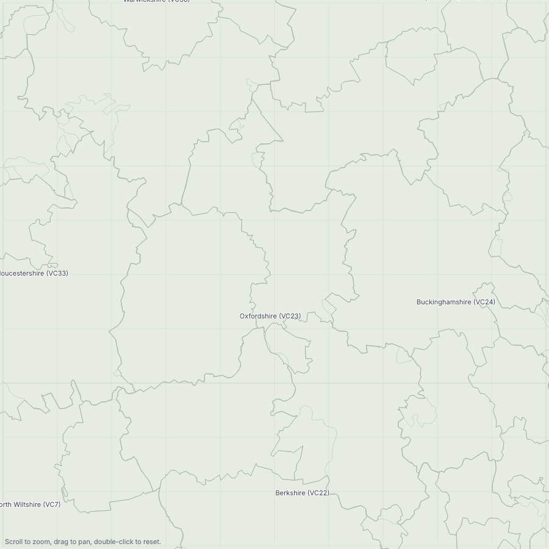

# Map background layers: what we have and what could be added

*Design note, 11 Oct 2026 (Round 3, Test 3 and Test 4 follow-ups). Research only: no app code
was changed. Wil asked: "what other background layers are available for mapping (with toggles)".
This note answers it in three parts: what the Mapping tab draws now, which open-licence layers
exist, and a recommended short list with toggles, build method and effort.*

---

## 1. Summary

- **The thin grey lines Wil saw are modern local-authority districts, not vice-counties.**
  The "coastline" file `data/maps/gb_outline.json` was made on 27 Aug 2026 from the **2013 ONS
  local authority district boundaries** (380 districts, via martinjc/UK-GeoJSON). The map draws
  the outline of every district in the **coast** colour (`#9fb0a0`, 0.7 px). So Cherwell, West
  Oxfordshire, Vale of White Horse and the rest all appear as lines, and they are **darker than
  the vice-county lines** (`#c2ccc1`, 0.5 px, almost the same as the land colour). That is why
  the VCs seem to have no outline. The screenshot below is the Mapping tab around Oxfordshire,
  rebuilt from the same source: the dark lines are districts, and the VC lines are the faint
  pale ones.
- **There is no water layer.** The "estuaries" are gaps in the land, because the ONS boundaries
  are clipped to the coast. Lakes do not show, because only the outer ring of each district was
  kept.
- **Licence gap:** the atlas PNG footer says only "Vice-county boundaries: BRC." The land and
  coast come from ONS/OS data under the Open Government Licence, which needs an attribution line.
  Add it now, whatever else is decided (one line in `atlas_sheet.py`).
- **Recommendation:** use **OS Open Zoomstack** (one OS download under the OGL, covering all of
  GB, already generalised) for land, rivers and lakes, woodland, built-up areas and main roads.
  Add **OS Terrain 50** for a relief shading. Keep the BRC VCs and give them a proper line. Put
  the districts behind their own toggle, off by default. All of this goes in a **"Layers ▾"
  menu** on the display bar. Protected sites (SSSI) are a sensible phase 2. Avoid UKCEH Land
  Cover Map: its licence does not allow free commercial use.

---

## 2. What the map draws now

The Mapping tab (`shared/maps/grid_map.py`, `GridMap.draw`) draws these, bottom to top. Data
Entry's "All my records" map (`species_dist_map.py`) draws the same set with the same colours.
Batch maps (`Observatum/src/views/mapping/batch_render.py`) use `GridMap`, so whatever is
decided here applies to them too.

| # | Layer | Drawn as | Source and file | Licence / attribution | Size | How it was built |
|---|---|---|---|---|---|---|
| 1 | Sea | Flat fill `#dbe9f4` | none (background colour) | none | none | none |
| 2 | Land | Fill `#e7ece3` | `data/maps/gb_outline.json`: **ONS Local Authority Districts, Dec 2013, generalised clipped** (LAD13CD), from github.com/martinjc/UK-GeoJSON `json/administrative/gb/topo_lad.json` | OGL. Required wording: "Contains Ordnance Survey, Office of National Statistics, National Records Scotland and LPS Intellectual Property data © Crown copyright and database right [2016]". **Not currently in the footer.** | 960 KB (1,086 rings, 61,503 points) | One-off in a chat on 27 Aug 2026: TopoJSON decoded, outer ring of each district polygon, WGS84→OSGB, Douglas–Peucker at 200 m. **No build script in the repo; the file is not in git** (`data/` is ignored). Rebuilt here byte-for-byte in size (983,516 bytes) to confirm. |
| 3 | VC boundaries | Outline `#c2ccc1` 0.5 px; VCs with records get a 16 % moss tint | `data/maps/vc_brc_wgs84.geojson` (112 VCs), from `vc_brc.shp` | BRC vice-counties (github.com/BiologicalRecordsCentre/vice-counties). BRC's page credits "Based on work by BRC and NBN". The footer says "Vice-county boundaries: BRC." | shp 56.7 MB; geojson 14.3 MB | `scripts/convert_vc_shapefile.py` (pyshp + pyproj, keeps every 5th point, small rings kept whole); thinned again at load (300 m) in `vc_map.py` |
| 4 | "Coast" | Polyline `#9fb0a0` 0.7 px **round every land ring** | same as 2 | same as 2 | none | **This is where the district lines come from:** every district outline is stroked, not just the coast. |
| 5 | National grid | 100 km lines `#c8d2cb` 0.5 px always; 10 km lines `#b9c6bd` 0.3 px when the view spans ≤ 250 km | computed | none | none | `GridMap._draw_grid` |
| 6 | Squares, selected square, selected VC outline, VC labels | (data, not background) | none | none | none | none |

**Fallback:** if `gb_outline.json` is missing, land comes from the VC polygons (thinned at
100 m), and the message "No coastline file found" appears.

**Also in the repo, but not on the Mapping tab:**

| Item | Where used | Source / licence | Notes |
|---|---|---|---|
| OS 1:250 000 Scale Colour Raster tiles (`data/maps/ras250/{SP,TQ,…}.tif`, 4000 px per 100 km, 25 m/px) | Data Entry "This record" mini-map and the Add Specimen dialog (`raster_map.py`) | OS OpenData, OGL: "Contains OS data © Crown copyright and database right [year]" | On Wil's PC only. This raster is where a full OS-style background (towns, roads, rivers, woods, admin lines) already exists, but only for the small location map. |
| `gb_basemap_250k.png` (the 250k tiles stitched into one 1400×2600 px image, 500 m/px) | **Nothing draws it now.** `DistributionMiniMap._mosaic` is always `None`; only `scripts/build_gb_basemap.py` and a test call `gb_basemap_path` | as above | Leftover from before the vector map. It could be retired, or reused as an "OS 1:250k picture" layer, though at 500 m/px it is too coarse for county view. |

---

## 3. Candidate open layers

Licence key: **OGL** = Open Government Licence v3.0. It allows commercial use, which matters
for Flauna reports, provided the attribution is shown. Sizes are the published download
sizes. "After build" is an **estimate** of the compact file the app would carry, and should be
measured when built.

### 3a. Ordnance Survey OpenData (all OGL, all GB)

OS attribution for every OS OpenData product: **"Contains OS data © Crown copyright and
database right 2026"**.

| Product | What it shows | Format, download size | Generalisation needed | Value to an ecologist | After build (est.) |
|---|---|---|---|---|---|
| **OS Open Zoomstack** | One GB product with layers: `land`, `foreshore`, `surfacewater`, `waterlines` (typed National / Regional / District / Local / MHW / MLW), `woodland`, `urban_areas`, `greenspace`, `national_parks`, `roads` (Motorway / Primary / A / B …), `rail`, `contours` (10 m), `boundaries` (national only), `names` | GeoPackage, **3.8 GB zipped, 11.8 GB unzipped**, British National Grid (EPSG:27700); also vector tiles | Already generalised for small scales (urban areas are explicitly "for smaller scales"; waterlines are typed by scale). Still needs a tolerance and a minimum area per level of detail. | **High.** A single source, licence and download gives coast, water, woodland, towns and roads that line up with each other. | land 0.5–1 MB; rivers+lakes 1–3 MB; woodland 3–8 MB (two levels of detail); urban 1–2 MB; main roads 0.5–1 MB |
| **OS Open Rivers** | Watercourse centre-lines (~144,000 km) with names and flow direction; includes tidal estuaries and canals | Shapefile / GeoPackage / GML; nominal scale 1:25 000; twice-yearly | Yes: filter to named or main rivers for GB view; thin to 50–100 m | High for aquatic/riparian taxa; rivers explain linear distributions | 1–3 MB |
| **OS Open Roads** | Road network, classified | GeoPackage **~973 MB zipped** (shapefile ~566 MB) | Yes: keep motorways and A roads only | Low–medium: orientation only, and it clutters | <1 MB (main roads only) |
| **OS Open Built Up Areas** | Built-up area polygons (settlements), with names | GeoPackage **~279 MB**; every two years since Dec 2022 | Light: simplify to 25–50 m | Medium: urban edges explain gaps, and urban/brownfield species | 1–2 MB |
| **OS Terrain 50** | 50 m height grid (DTM), plus 10 m contours | ASCII grid, **157 MB compressed** for GB; annual (July) | Resample to 200–250 m and compute a hillshade; store as one greyscale PNG | Medium–high: uplands vs lowlands explains many invertebrate ranges; very good on GB atlas pages | 2–5 MB PNG at 250 m/px (2,600 × 4,900 px) |
| **Boundary-Line** | Admin and electoral boundaries (counties, districts, unitary, wards, parishes), ceremonial and historic counties (c.1888), and the **mean high water line** (code 0071) | Shapefile / GeoPackage, several hundred MB | Dissolve and simplify | Low–medium: modern counties are what clients ask about. MHW is a precise coastline. Overlaps with Zoomstack `land`. | <1 MB per level |

### 3b. Statutory nature data (country agencies)

| Dataset | What it shows | Source, licence, **exact attribution** | Format / size | Generalisation | Value |
|---|---|---|---|---|---|
| **SSSI (England)** (and SSSI units) | Statutory site boundaries | Natural England, OGL. "© Natural England copyright. Contains Ordnance Survey data © Crown copyright and database right [year]." | Shapefile / GeoPackage / GeoJSON (NE Open Data); tens of MB | Light (10–25 m); drop at GB scale (sites become specks) | **High at county and tetrad scale:** records near designated sites, condition assessment context |
| **SSSI (Scotland)** | as above | NatureScot (formerly SNH), OGL v3. NBN layer credit: "Contains SNH information licensed under the Open Government Licence v3.0." | NatureScot downloads / WFS | as above | as above |
| **SSSI (Wales)** | as above | Natural Resources Wales on DataMapWales, OGL v3, published 12 Aug 2026. "Contains Natural Resources Wales information © Natural Resources Wales and Database Right. All rights Reserved." plus "Contains Ordnance Survey Data. Ordnance Survey Licence number AC0000849444. Crown Copyright and Database Right." | GeoPackage, GeoJSON, Shapefile … | as above | as above |
| NNR / LNR (England, Scotland, Wales) | Reserve boundaries | Same three agencies, OGL, same wording | small | light | Medium; could go in a "Protected sites" layer with the SSSIs |
| **Ancient Woodland Inventory (England)** | Ancient semi-natural and replanted woodland ≥ ~2 ha (52,000+ sites) | Natural England, OGL. "© Natural England copyright. Contains Ordnance Survey data © Crown copyright and database right [year]." Updated monthly. | tens of MB | moderate | **High for saproxylic beetles** (longhorns!). England only; Wales (NRW) and Scotland (NatureScot) keep their own AWIs (check each licence on download) |
| National Forest Inventory woodland | All woodland ≥ 0.5 ha, by type | Forestry Commission, OGL. "Contains, or is based on, information supplied by the Forestry Commission. © Crown copyright and database right [year] Ordnance Survey [100021242]." Published per country, annual. | large (hundreds of MB) | heavy | High, but Zoomstack `woodland` gives a GB-consistent picture for a background |
| Priority Habitats Inventory (England) | 27 priority habitats, OS MasterMap-based | Natural England, OGL (some CC BY 4.0 parts: Cumbria WT grassland). NE wording as above. Updated twice a year. | very large (GB-wide GeoPackage, several GB unzipped) | heavy; England only | High for site work, but too detailed and too big for a background layer. Better as a future per-site lookup. |
| National Character Areas (England, 159) | Landscape regions | Natural England, OGL, NE wording | small | light | Medium: an alternative way to group records, rather than a background |
| National Parks | 15 parks (GB) | in Zoomstack (OS, OGL) | tiny | none | Low–medium; context on GB pages |

### 3c. Land cover (licence warnings)

| Dataset | Licence position | Verdict |
|---|---|---|
| **UKCEH Land Cover Map** (LCM2023, 25 m / 10 m) | **"Controlled… Bespoke licensing conditions apply"**: download needs a licence negotiated with UKCEH Data Licensing; commercial use is not free. (Defra-family bodies have their own access.) | **Do not bundle.** Flauna is a commercial user; any map showing it would need a paid licence, and redistributing it inside the app is not allowed. |
| **CORINE Land Cover 2018** (UK, via UKCEH/EIDC) | Copernicus data, free and open; acknowledge "with funding by the European Union" (Copernicus Land Monitoring Service, EEA) | Usable, but the **25 ha minimum mapping unit** makes it too coarse at tetrad scale. Zoomstack woodland and urban cover the useful parts. Not recommended. |

### 3d. Offline and size implications

- The app is offline. Every layer must be **downloaded once by a build script, then shipped as
  a compact file** in `data/maps/layers/`. Raw downloads (Zoomstack 3.8 GB, Open Roads 1 GB)
  must never be read at run time.
- **GeoPackage is SQLite.** The build script can read Zoomstack with Python's own `sqlite3`.
  Geometry is a small GPKG header plus WKB, decoded with shapely at build time (already used
  by `create_vc_lookup_db.py`). Neither GDAL nor anything new is needed at run time.
- **Two levels of detail per polygon layer:** a GB level (simplified at about 250 m, polygons
  under about 50 ha dropped) and a county level (about 25 m, under about 1 ha dropped), loaded
  only when zoomed in (the same 250 km threshold that turns on the 10 km grid).
- Total shipped for the recommended set: **about 10–20 MB** (estimate), comparable to the VC
  GeoJSON already carried (14 MB).
- Paint speed: woodland at county detail can run to tens of thousands of rings. Bucket rings by
  100 km square at build time, draw only the buckets in view, and cache the background as a
  pixmap per view, as `species_dist_map._build_land_pixmap` already does.

---

## 4. Recommendation

### 4a. The short list

| Draw order (bottom→top) | Toggle name | Source | Default | Why |
|---|---|---|---|---|
| 1 | *(Sea + Land: always on)* | **Zoomstack `land`** (or Boundary-Line MHW), replacing the district-built outline | always | Removes the district lines from the land itself; a proper coast; a reproducible build |
| 2 | **Relief** | OS Terrain 50 hillshade | off | Explains upland/lowland patterns at a glance; lovely on GB atlas pages. Off by default so the squares stay the strongest thing on the map. |
| 3 | **Woodland** | Zoomstack `woodland` | off | The habitat most of Wil's work turns on (saproxylics, longhorns). Pale green-grey tint. |
| 4 | **Towns** | Zoomstack `urban_areas` | off | Explains gaps and urban-edge records; helps place a tetrad |
| 5 | **Rivers and lakes** | Zoomstack `waterlines` (National/Regional at GB scale, + District when zoomed) + `surfacewater` | **on** | Best orientation aid at county scale. Also restores the estuaries and big lakes properly. Thin pale blue, so it stays quiet. |
| 6 | **Main roads** | Zoomstack `roads` (Motorway, Primary, A) | off | Orientation at county and tetrad scale; clutter at GB scale |
| 7 | **Vice-counties** | BRC (existing) | **on** | Answers Test 3: a clear line (e.g. `theme.MUTED`-ish, 0.8 px), drawn above the land layers |
| 8 | **Districts (modern)** | ONS 2013 lines from today's file, or Boundary-Line districts/unitary (current) | off | What the "thin lines" are now; some clients think in councils |
| 9 | **Grid** | computed (existing) | **on** | unchanged |
| (data) | squares, VC outline, labels | none | none | always on top |

**Phase 2 (not in the first build):** **Protected sites** (SSSI and NNR from Natural England,
NatureScot and NRW, merged into one layer, shown only when zoomed in) and **Ancient woodland**
(England AWI first). Both are high value for site reports, but they need three sources and
three attribution lines, and they make sense only at county or tetrad scale.

**Not recommended:** UKCEH Land Cover Map (licence), CORINE (too coarse), Priority Habitats
Inventory (too big for a background; better as a later per-site lookup), contours (relief
does the job more quietly), rail and greenspace (clutter).

### 4b. Toggle UI

- A **"Layers ▾"** `QToolButton` with a drop-down menu on the display bar, next to "VC labels".
  It holds one tick-able item per layer, in draw order. "VC labels" can move into the same menu,
  so the bar does not grow.
- Each choice is remembered (`QSettings` `mapping/layers/<key>`, as `mapping/vc_labels` is
  now).
- If a layer's file has not been built, its item is greyed out with the tooltip "Not installed:
  run scripts\build_map_layers.py".
- The batch maps use the same remembered choices.
- A small "Reset to defaults" item at the bottom.
- **Implementation outline:** a `shared/maps/layers.py` registry. Each entry carries a key, a
  label, a file, a kind (polygon / line / raster), a style taken from `theme()`, a default on or
  off, the zoom at which county detail switches on, and an attribution string.
  `GridMap.draw()` loops over the registry instead of the hard-coded land/VC/coast/grid block.
  Colours come from `theme()`; nothing is hardcoded.

### 4c. Build approach

`scripts/build_map_layers.py` follows the pattern of `build_gb_basemap.py`: safe to re-run, and
it writes only `data/maps/layers/*`. It never touches a database.

1. Wil downloads the source files once from the OS Data Hub: Zoomstack GeoPackage; Terrain 50
   ASCII grid. The script prints the exact links. The files go in `data/maps/sources/`, and the
   script can be pointed elsewhere with `--source`.
2. For each layer it reads the GeoPackage table with `sqlite3`, decodes the geometry with
   shapely, filters by type (e.g. waterlines National/Regional), clips to GB, applies
   `simplify(tol, preserve_topology=True)` and drops slivers below the minimum area. It does
   this twice, once per level of detail.
3. Output: one compact JSON per layer and level, in the **same shape as `gb_outline.json`**
   (integer OSGB metres), plus a `"bbox"` bucket index and an `"attribution"` string. Relief is
   one greyscale PNG plus a small `.json` holding its OSGB extent.
4. A `--check` option prints each layer's file size, ring count and point count, so the shipped
   size is measured, not guessed.
5. The same script rebuilds **land** from Zoomstack. This retires the one-off,
   un-reproducible `gb_outline.json`. That file is kept, and moved to `_archive` only once the
   new land is approved.

Run-time cost: no new dependency (shapely and numpy are needed at build time only; run time is
pure QPainter, as now).

### 4d. Effort

| Item | Effort |
|---|---|
| Footer attribution fix for today's land file (do now) | 15 min |
| VC line restyle + "Districts" toggle, using the existing file (answers Test 3 straight away) | 2–3 h |
| Layer registry, "Layers ▾" menu, settings, footer attribution built from the layers drawn, tests | 0.5 day |
| `build_map_layers.py` framework + Zoomstack reader + **land** | 0.5 day |
| Rivers and lakes | 2–3 h |
| Woodland (two levels of detail, bucketing, paint-speed check) | 0.5–1 day |
| Towns | 1–2 h |
| Main roads | 1–2 h |
| Relief (Terrain 50 → hillshade PNG, drawn under the land tints) | 0.5 day |
| *Phase 2:* Protected sites (3 sources merged) | 1 day |
| *Phase 2:* Ancient woodland (England; Wales/Scotland later) | 0.5 day |
| **First build total** | **about 3–4 days** |

### 4e. Atlas PNG export

The atlas page should be **what you see**: every layer that is ticked is printed. The footer's
credit line is built from the layers actually drawn, not fixed text:

| Layer on the page | Footer adds |
|---|---|
| Land / rivers / woodland / towns / roads / relief (any OS layer) | "Contains OS data © Crown copyright and database right 2026." (once, however many OS layers) |
| Today's land file (until replaced) | The source's own wording: "Contains Ordnance Survey, Office of National Statistics, National Records Scotland and LPS Intellectual Property data © Crown copyright and database right 2016." |
| Vice-counties | "Vice-county boundaries: BRC." (as now) |
| Districts (ONS file) | covered by the ONS line above |
| Protected sites (phase 2) | NE + NatureScot + NRW lines (see 3b), only for the countries in view |
| Ancient woodland (phase 2) | "© Natural England copyright. Contains Ordnance Survey data © Crown copyright and database right 2026." |

Print suitability:
- **Good on atlas pages:** Relief, Rivers and lakes, Woodland. They stay pale under coloured
  squares.
- **Usually off for print:** Towns, Main roads and Districts, which compete with tetrad squares.
- The footer is one 7 pt line now. With several credits it may need to wrap to two lines;
  `atlas_sheet.py` would need about 3 mm more bottom margin.

---

## 5. Decisions for Wil

1. **Data source:** is a one-off **3.8 GB** Zoomstack download acceptable? It is the simplest,
   because one source gives everything. If not, the alternatives are separate products: Open
   Rivers, Open Built Up Areas (279 MB), NFI woodland per country, Boundary-Line coast. Same
   result, more scripts.
2. **Defaults:** are rivers on and the rest off right? Should anything be on by default in
   County view only?
3. **Districts:** keep them as a toggle (off), or drop them? If kept, should they be 2013 (as
   now) or current Boundary-Line?
4. **Atlas:** print what is ticked (recommended), or have separate "print" ticks?
5. **Phase 2:** are protected sites and ancient woodland wanted, and is England first
   acceptable?

---

## Sources

- martinjc/UK-GeoJSON (source of `gb_outline.json`; licence and attribution wording):
  https://github.com/martinjc/UK-GeoJSON (mirror read: https://github.com/BeastNeedsMoreTorque/UK-GeoJSON);
  file: https://raw.githubusercontent.com/martinjc/UK-GeoJSON/master/json/administrative/gb/topo_lad.json
- BRC vice-counties: https://www.brc.ac.uk/node/269 · https://github.com/BiologicalRecordsCentre/vice-counties
- OS OpenData attribution (OGL v3): https://gisinfo.hertfordshire.gov.uk/os/osopendata.htm ·
  https://www.ordnancesurvey.co.uk/business-government/licensing-agreements/copyright-acknowledgements
- OS Open Zoomstack, layers: https://docs.os.uk/os-downloads/products/maps-and-imagery-portfolio/os-open-zoomstack/os-open-zoomstack-technical-specification/list-of-layers ;
  size and format: https://docs.os.uk/os-downloads/products/maps-and-imagery-portfolio/os-open-zoomstack/os-open-zoomstack-technical-specification ;
  attribute values: https://docs.maptiler.com/schema/uk-openzoomstack/
- OS Open Rivers: https://ordnancesurvey.co.uk/products/os-open-rivers ·
  https://www.data.gov.uk/api/2/rest/harvestobject/d5d0a390-4158-43b4-b9e5-149c0bdc921b/html ·
  https://docs.os.uk/os-downloads/networks/os-open-rivers/os-open-rivers-overview/product-supply
- OS Open Roads sizes: https://docs.os.uk/os-downloads/products/transport-network-portfolio/os-open-roads/os-open-roads-overview/coverage-and-file-sizes.md
- OS Open Built Up Areas: https://docs.os.uk/os-downloads/products/areas-and-zones-portfolio/os-open-built-up-areas/os-open-built-up-areas-overview/product-supply
- OS Terrain 50: https://docs.os.uk/os-downloads/products/land-and-terrain-portfolio/os-terrain-50/os-terrain-50-overview/product-supply
- Boundary-Line: https://docs.os.uk/os-downloads/products/areas-and-zones-portfolio/boundary-line/boundary-line-downloads ·
  coastline: https://docs.os.uk/os-downloads/products/areas-and-zones-portfolio/boundary-line/boundary-line-product-information/the-coastline-and-associated-items
- Natural England SSSI (licence and attribution): https://gisinfo.hertfordshire.gov.uk/metadata/NaturalEngland/SSSI.htm ·
  https://www.data.gov.uk/dataset/c52ead19-47c2-473b-b087-0842157e00b6/sites-of-special-scientific-interest-units-england1
- Natural England Ancient Woodland Inventory: https://gisinfo.hertfordshire.gov.uk/metadata/NaturalEngland/ancientwoodland.htm ·
  https://www.planning.data.gov.uk/dataset/ancient-woodland
- Priority Habitats Inventory (England): https://www.data.gov.uk/dataset/priority-habitats-inventory-england
- National Character Areas: https://www.data.gov.uk/dataset/national-character-areas-england1
- NatureScot SSSI: https://layers.nbnatlas.org/ws/layers/view/more/SSSI_SCOTLAND_Dec2020_FINAL ·
  https://spatialdata.gov.scot/geonetwork/srv/api/records/fca4eb4e-304e-448e-8d23-ddcb4a98371e
- NRW SSSI: https://datamap.gov.wales/layers/inspire-nrw:NRW_SSSI/metadata_detail
- National Forest Inventory (England 2017 record; licence and attribution):
  https://www.data.gov.uk/api/2/rest/harvestobject/3fc799e8-5d99-4690-ae4a-ddc9e9c4bb74/html
- UKCEH Land Cover Map 2023 (controlled, bespoke licence):
  https://www.data.gov.uk/api/2/rest/harvestobject/c6901971-6994-4927-af4f-6e8dacf1b46c/html ·
  https://ckan.publishing.service.gov.uk/dataset/land-cover-map-2023-25m-rasterised-land-parcels-gb
- CORINE Land Cover 2018 (UK): https://www.data.gov.uk/dataset/corine-land-cover-2018-for-the-uk-isle-of-man-jersey-and-guernsey
- Code read: `shared/maps/grid_map.py`, `species_dist_map.py`, `vc_map.py`, `gb_basemap.py`,
  `raster_map.py`, `atlas_sheet.py`; `scripts/build_gb_basemap.py`, `convert_vc_shapefile.py`;
  `Observatum/src/views/mapping/display_bar.py`, `mapping_tab.py`, `batch_render.py`.
  The provenance of `gb_outline.json` comes from the 27 Aug 2026 chat "Organizing project files
  and updating dev logs".
